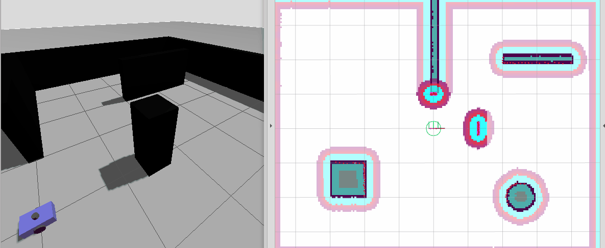

# diffdrive_nav2_ros2

A differential-drive robot built from scratch (URDF/Xacro) and driven by Nav2 in Gazebo Harmonic with ROS2 Jazzy. It localizes on a saved map with AMCL and drives to a goal, going around an obstacle that is not in the map. Phase 2 adds moving obstacles: C++ lidar detection, Kalman tracking, and a custom Nav2 costmap layer that marks where a moving obstacle will be.



*Left: Gazebo. Right: RViz. The box in the middle is not in the saved map; the robot sees it only with its lidar and drives around it. (Static obstacle; no GIF of the moving case yet.)*

## Status
- [x] Robot description (chassis, wheels, front and rear casters, 2D LiDAR)
- [x] Gazebo simulation with differential-drive plugin
- [x] Teleop control, `/odom` and `/scan` publishing
- [x] SLAM (slam_toolbox) and a saved map
- [x] Nav2 autonomous navigation with AMCL
- [x] Unmapped obstacle test: 5 passes in a row (git tag `phase1-gate`)
- [x] Moving obstacle in the world (`moving_box`, driven back and forth by `scripts/moving_obstacle.py`)
- [x] C++ lidar obstacle detection (scan clustering library + ROS2 node, gtest)
- [x] Constant-velocity Kalman tracker with gated nearest-neighbour association (gtest)
- [x] Predictive costmap layer: Nav2 plugin that marks where tracked obstacles will be in the next 1.5 s (gtest for the maths)
- [ ] Not yet done: predictions in the global costmap, end-to-end test with vs without the predictive layer (pass rule, 5 runs each), and a GIF

## World and robot
- World: `worlds/test_world.sdf` (4 outer walls, a partition, a side wall, a box, a cylinder, and `unmapped_box`).
- `unmapped_box` (0.4 x 0.4 x 1 m at world (1.5, 0)) is **not** in the saved map `maps/test_world_map` (198 x 158 cells, 0.05 m). Nav2 only sees it through the lidar.
- Moving-obstacle world: `worlds/test_world_moving.sdf`, the same world without `unmapped_box`, plus `moving_box` (0.3 x 0.3 x 0.4 m) that drives back and forth along x = 1.5 between y = -1.0 and y = +1.0 at 0.25 m/s. Selected with `moving_obstacle:=true`; the default is the old world, so old results stay reproducible.
- Robot: two drive wheels plus a front and a rear caster.
- Nav2 params (`config/nav2_params.yaml`) start from Nav2's TurtleBot3 defaults: NavFn planner, MPPI controller, `collision_monitor`. Changes: `base_footprint`, `robot_radius` 0.2, initial pose (0, 0, 0), `inflation_radius` 0.7 -> 0.4 (local and global).

## Run it
Needs ROS2 Jazzy, Gazebo Harmonic, ros_gz, navigation2 and nav2_bringup. Nav2 and the launch files read the **installed** copy of this package, so rebuild after every edit:
```
cd ~/ros2_ws && colcon build --packages-select diffdrive_nav2_ros2 && source install/setup.bash
```
**One command (Gazebo, then Nav2, optionally RViz):**
```
ros2 launch diffdrive_nav2_ros2 bringup.launch.py rviz:=true
```
Arguments: `headless:=true` (no Gazebo window), `rviz:=true`, `nav2_delay:=15` and `rviz_delay:=15` (seconds; Nav2 starts after a fixed delay, it does not wait for Gazebo), `moving_obstacle:=true` (moving-box world), `predictive_layer:=true` (adds the predictive layer to the local costmap). Wait for "Managed nodes are active" twice (about 30 s), then send the goal below from a second terminal. The manual three-terminal start below does the same steps; `scripts/run_batch.sh` uses the manual start.

Terminal 1, Gazebo (add `headless:=true` for no window):
```
ros2 launch diffdrive_nav2_ros2 gazebo.launch.py
```
Terminal 2, Nav2 (wait for "Managed nodes are active" twice). Do not run slam_toolbox at the same time:
```
PARAMS=$(ros2 pkg prefix diffdrive_nav2_ros2)/share/diffdrive_nav2_ros2/config/nav2_params.yaml
MAP=$(ros2 pkg prefix diffdrive_nav2_ros2)/share/diffdrive_nav2_ros2/maps/test_world_map.yaml
ros2 launch nav2_bringup bringup_launch.py map:=$MAP params_file:=$PARAMS use_sim_time:=true
```
Terminal 3 (optional), RViz:
```
ros2 run rviz2 rviz2 -d /opt/ros/jazzy/share/nav2_bringup/rviz/nav2_default_view.rviz --ros-args -p use_sim_time:=true
```
Terminal 4, goal (map frame, (3.0, 0.0), heading +x):
```
ros2 action send_goal /navigate_to_pose nav2_msgs/action/NavigateToPose "{pose: {header: {frame_id: map}, pose: {position: {x: 3.0, y: 0.0}, orientation: {z: 0.0, w: 1.0}}}}" --feedback
```
Batch runner (full restart per run, results table, logs in `~/run_logs`, refuses to overwrite a used prefix):
```
bash scripts/run_batch.sh PREFIX COUNT HEADLESS(true|false) RVIZ(true|false)
```
Before relaunching, check that no old simulation is still running (headless Gazebo does not always stop on Ctrl+C; a leftover one makes the new launch connect to the old world):
```
pgrep -af '[g]z sim|[c]omponent_container|[r]viz2'
```

## Phase 2: moving obstacles (in progress)
Goal: the robot plans around where a moving obstacle **will be**, not only where it is now.

Built with Claude Code as a pair programmer. I wrote the Kalman filter predict/update, the data association, and the prediction and grid maths myself; the ROS/Nav2 plumbing is AI-written and reviewed by me.

Pipeline (all algorithm code is plain C++17, separate from the ROS2 wrappers, and unit-tested with gtest):
1. **Detection** (`src/perception/`): split the 2D scan where neighbouring points are farther apart than `0.03 + 0.112 * range`, drop small groups (< 3 points), long groups (walls, > 0.6 m) and occluded groups (pieces of a wall cut off by something closer, whose centre would move with the shadow). Output: one centroid per object, transformed to `odom` at the scan stamp (`/detected_obstacles`). It finds objects, it does not classify them.
2. **Tracking** (`src/tracking/`): constant-velocity Kalman filter per object, state `[x, y, vx, vy]`. Each scan: predict, match detections to tracks (greedy nearest neighbour, smallest distance first across all pairs, 0.5 m gate), update, delete tracks missed for > 5 scans. Speed is never measured; the filter infers it from how positions change. `dt` comes from the scan stamps. Only tracks faster than 0.1 m/s are published (`/tracked_obstacles`, arrows in RViz), so static things like a wall end are dropped.
3. **Prediction + costmap layer** (`src/prediction/`, `src/costmap/`): for each track, predict positions every 0.1 s up to 1.5 s ahead and mark a disc (obstacle + robot radius) around each one in the local costmap. Cost falls from 252 (now) to 140 (1.5 s ahead). It never reaches 253/254, so a prediction raises cost but never forbids space: a constant-velocity prediction is wrong every time the obstacle turns, and a guess should not be able to block every path.

Run (moving box + predictive layer; detector and tracker in separate terminals):
```
ros2 launch diffdrive_nav2_ros2 bringup.launch.py moving_obstacle:=true predictive_layer:=true rviz:=true
ros2 launch diffdrive_nav2_ros2 perception.launch.py
ros2 launch diffdrive_nav2_ros2 tracking.launch.py
ros2 service call /moving_obstacle/start std_srvs/srv/Trigger
```

What is verified so far:
- Unit tests: 7 clustering, 7 tracker, 17 prediction (`colcon test --packages-select diffdrive_nav2_ros2`).
- Moving box (run `mobA_01`, 180 s sim, headless, robot idle): stays on its line (x error 0.000 m), 22 turnarounds all within 0.009 m of ±1.0 m, no tilt, lidar range within 0.033 m of the true box face.
- Detector (runs `percA_01`, `percB_01`, 180 s sim, robot idle, box moving): the box was found within 0.25 m of its true centre in all 1800 scans, with no other false detections. One exception was excluded before the run: the end of the partition wall looks exactly like a small object. The tracker removes it later because it doesn't move. Caveat: the detector settings were tuned on recorded scans from the same world.
- CPU: with `use_sim_time` the detector used 18% of a core and failed my 10% rule. Cause: `/clock` is bridged at about 1 kHz (measured 980-1000 Hz), and every sim-time node processes all of it. On wall time it used 1.5%, with the same detection. The detector, tracker and obstacle script now run on wall time and take sim time from the message stamps. One run per setting.
- Live check by eye: the tracker's arrow follows the box and flips at each turnaround; no arrow on the partition end. With the layer on, the local costmap shows the predicted cost ahead of the box.

Not verified yet:
- Whether the predictive layer changes anything end to end (no with/without runs yet).

Hand-driven runs (not a result, random timing, about 4 goals with the layer on and off):
- With the layer on, the robot once bent its path away from the box before the crossing.
- Side approaches still ended in contact, with the layer on and off.
- My hypothesis (not confirmed): only the local costmap has the predictions. The global planner (NavFn) plans around where the box is now, and the short way around a crossing obstacle is usually the side it is moving into. MPPI then follows that path. Next step: add the layer to the global costmap as well.

Known limits:
- The detected centroid sits on the visible face of an object (up to ~0.15 m in front of a 0.3 m box's centre).
- Constant-velocity model only.
- Tracks live in the drifting `odom` frame.
- A 2D costmap has no time, so a cell marked for t = 1 s also penalises the robot passing there at t = 0.2 s.
- The test box is driven by Gazebo's VelocityControl, which forces its speed: on contact it pushes the robot sideways, which breaks odometry and AMCL. A contact should be measured by distance and end the run.

## Results
Same goal every time, full restart before every run. "Runs with stops" = runs where `collision_monitor` stopped the robot at least once.
All results before Nov 4, 2026 used the old robot with only a rear caster.

**Gate (Oct 20, inflation 0.7, window on, RViz on):** 5 passes in a row, all on the -y side of the box. Pass rule, written before the runs: `SUCCEEDED`, no touch (by eye), nothing changed since the last run.

| Run | Time | Stops |
|---|---|---|
| 1 | 11.4 s | 0 |
| 2 | 11.3 s | 0 |
| 3 | 12.2 s | 0 |
| 4 | 17.9 s | 4 |
| 5 | 12.5 s | 1 |

**Batches since then (all runs SUCCEEDED):**

| Inflation | Setup | Runs | Time | Side | Runs with stops |
|---|---|---|---|---|---|
| 0.7 | headless, no RViz | 10 | 11-12 s | -y | 0 |
| 0.7 | headless, RViz on | 10 | 10-14 s | - | 1 |
| 0.4 | headless, no RViz | 10 | 9 s | +y | 0 |
| 0.4 | window on, no RViz | 5 | 8-9 s | +y | 0 |
| 0.4 | headless, no RViz (run by `scripts/run_batch.sh`) | 10 | 8-9 s | +y | 0 |
| 0.4 | window on, RViz on (run by `scripts/run_batch.sh`) | 10 | 8-10 s | +y | 1 |
| 0.4 | headless, no RViz, front caster (run by `scripts/run_batch.sh`) | 10 | 9 s | +y | 0 |
| 0.4 | window on, RViz on, front caster (run by `scripts/run_batch.sh`) | 5 | 9-10 s | +y | 1 |

- Lowering the inflation radius from 0.7 to 0.4 flipped the route from -y to +y and saved about 2-3 s. My calculation (not checked in a costmap): at 0.7 the inflated zones of the box and the partition leave about 0.04 m between them, at 0.4 about 0.64 m.
- Headless (`-s`) raised the simulation speed from about 0.62x to about 0.84x real time (measured from raw sim and real timestamps). It did not reliably reduce stops.
- **Launch-file test (Nov 2, old robot, not in the tables):** 3 runs with `bringup.launch.py`. Window on and headless took about 9 s. Window + RViz took 17 s with at least 14 `collision_monitor` stops. Startup timing differs from the batch runner, so these runs are not compared with the batches.

## Known issues and limits
- **collision_monitor stops (cause unconfirmed):** the lidar scan is stamped 1-110 ms newer than the latest `odom -> base_footprint` transform, so the monitor treats the scan as invalid and stops the robot for up to about 0.85 s. `transform_tolerance` is already 0.2 s, so a bigger tolerance does not explain it. It is intermittent: 3 of 6 runs on Oct 20, 2 of 55 batch runs from Oct 26 to Nov 1 (old robot), and 1 of 15 since the front caster (calB + vizC); batches run with the pitch recorder are excluded because the recorder added load. The setup did not predict which runs had stops. With the full moving-obstacle stack running (Gazebo, Nav2, RViz, detector, tracker), these stops appear every few seconds. One candidate cause, not tested: `/clock` at about 1 kHz loads every sim-time node (see the CPU result above).
- **Braking tilt (fixed):** Braking tilted the old robot 4.5-8.2 deg nose-down, and the lidar saw the floor as obstacles. Fixed with a front caster (tilt ~0.015 deg).
- **Collisions were judged by eye only in the gate runs and in 5 window runs at inflation 0.4.** Headless runs and scripted batches cannot show contact.
- **Odometry drifts in sim:** `map -> odom` reached 0.37 m / 2.8 deg after a few goals with in-place turns (cause not verified).
- **Goal tolerance is 0.25 m / 0.25 rad.** In one gate run the feedback heading was about 0.27 rad while Nav2 still reported `SUCCEEDED` (cause unknown). The pose in the feedback is AMCL's estimate, not Gazebo's true pose.
- **Narrow test:** one world, one goal, one static obstacle. The controller is MPPI from Nav2's defaults and has not been compared with other controllers.
- Window-mode scripted batches crashed three times before they worked (once with a WSL restart). Cause unknown.

## How it works
- **AMCL:** AMCL works out where the robot is on the saved map. Its inputs are the lidar scan, the saved map and the odometry. It keeps many guesses of the robot's pose (the particle cloud in RViz), moves them using odometry, and scores each one by how well the scan matches the map. The output is the `map -> odom` transform: the difference between where odometry says the robot is and where the map says it is. Odometry itself still drifts, and AMCL corrects for it through this transform. In one test, after a few goals with in-place turns, the offset grew to 0.37 m and 2.8 degrees. A known limit I did not test: in a room where every place looks alike, AMCL can lock onto the wrong spot.
- **Costmaps and inflation:** A costmap is a grid where each cell holds the cost of the robot being there, from free to blocked. The global costmap (static layer from the saved map, obstacle layer from the lidar, inflation layer) is what the planner uses to choose the route. The local costmap is a 3 m x 3 m window that moves with the robot (voxel layer from the lidar, plus inflation), and MPPI uses it while following the route. The inflation layer adds cost around obstacles, fading with distance until the inflation radius. I changed the radius from 0.7 to 0.4 in both costmaps. The robot then went around the other side of the box (+y instead of -y), and the run was about 2-3 s faster (11-12 s to 8-9 s). My explanation, not checked in a costmap: at 0.7 the inflated zones of the box and the partition left almost no cheap gap, and at 0.4 they left about 0.6 m.
- **MPPI:** MPPI is Nav2's controller. It follows the planner's path while avoiding obstacles, and it outputs a velocity command (forward speed and turn rate). Its inputs are the robot's state, the path, the local costmap and the goal. Every cycle (20 Hz) it adds random Gaussian noise to the previous control plan to make 2000 trajectories of 56 steps x 0.05 s, so 2.8 s ahead. Critics (path following, goal, costmap cost and others) give each trajectory a total cost, and each cost becomes a trust weight, highest for the cheapest. The temperature (0.3 here) sets how sharply cost differences change the weights: low means almost only the cheapest count, high means a plain average. The new plan is the old plan plus the weighted average of the noise. The first command goes to the robot, and the rest is reused next cycle. It is Nav2's default, and I have not compared it with other controllers.
- **Odometry drift:** Odometry is like closing your eyes and counting your steps across a room. Small errors in each step add up, so odometry drifts away from the true position and would mess up localization on its own. In my test, `map -> odom` reached 0.37 m and 2.8 degrees after a few goals with in-place turns. I did not test the cause. Wheel slip is a guess. AMCL compensates by changing `map -> odom`, so the pose on the map stays right while the odometry stays wrong.
- **TF timing and `collision_monitor`:** Each lidar scan has a timestamp, and to use it `collision_monitor` needs the robot's position at that moment, from the `odom -> base_footprint` transform. Sometimes the scan is stamped newer than the newest transform available (1-110 ms in my logs), and the lookup fails with 'extrapolation into the future'. `collision_monitor` is a safety check just before the wheels. When it can't place the scan, it stops the robot for a moment (0.05-0.85 s) and continues when a later scan works. These stops were not about a real obstacle. They happened in 3 of 6 runs on Oct 20, in 2 of 55 batch runs from Oct 26 to Nov 1, in 1 of 15 since the front caster, and in one launch-file run with at least 14 stops. The cause is unconfirmed. One candidate is machine load: the simulation ran at about 0.62x real time with Nav2 and RViz running, and `/odom` messages arrived unevenly in one test. But headless mode and RViz off did not reliably prevent the stops. `transform_tolerance` is already 0.2 s, so a larger tolerance does not explain it.
- **Kalman filter (tracker):** The state is position and speed. Predict moves the guess forward with the current speed and makes it less certain. Update compares the prediction with the new detection and moves the guess part of the way toward it; the Kalman gain decides how far, from how unsure the prediction is versus how noisy the detector is. The detector only gives positions, but the filter links position and speed errors, so a detection that lands ahead of the prediction also raises the speed estimate. Two settings: measurement noise (how much detections jitter) and process noise (how suddenly the obstacle can change speed, for example when the box turns around).

## Files
`src/` and `include/` C++ code (perception, tracking, prediction, costmap layer), `test/` gtest unit tests, `msg/` tracked-obstacle messages, `config/` Nav2 params and the predictive-layer overlay, `launch/` Gazebo, bringup, perception and tracking launch files, `maps/` saved map, `urdf/` robot, `worlds/` test worlds, `scripts/` batch runner, moving-obstacle script and measurement scripts, `NOTES.md` lab notes, `DECISIONS.md` choices and evidence, `CLAUDE.md` project rules for Claude Code.
